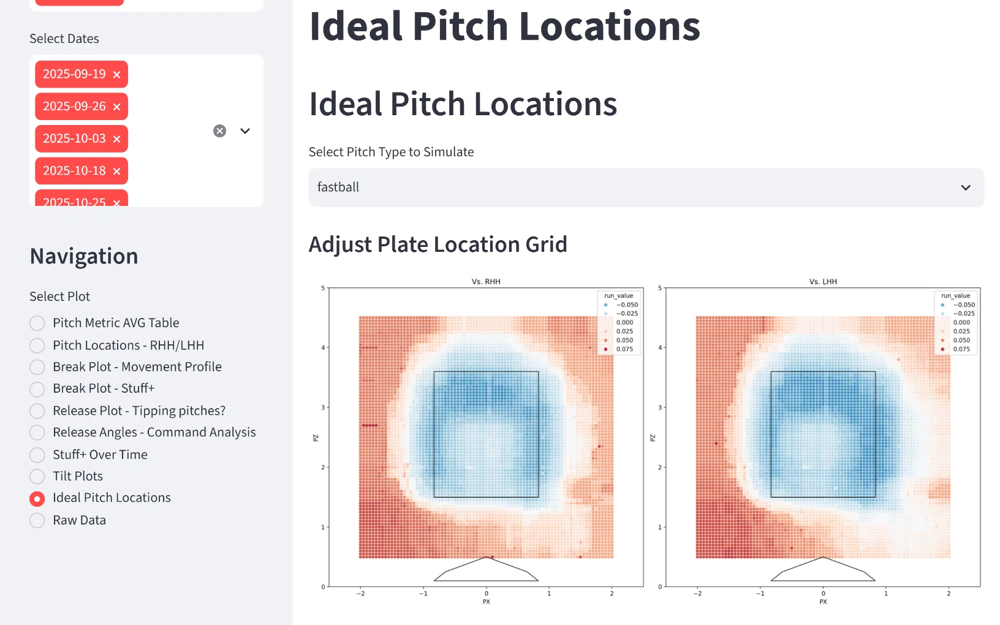
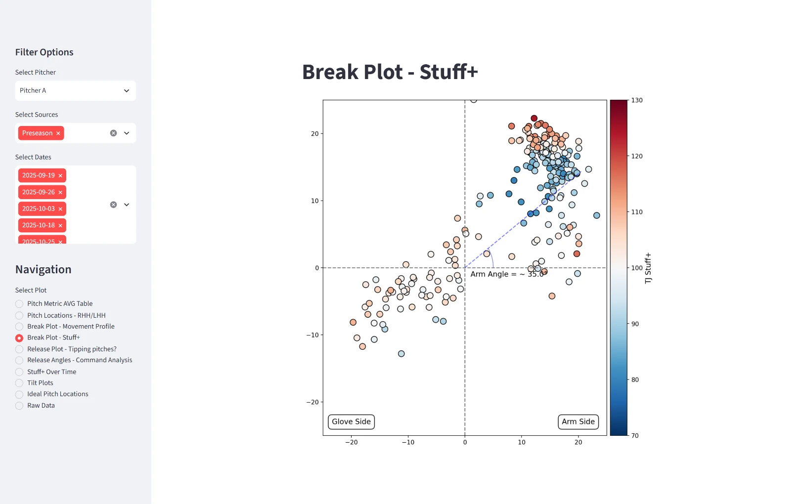
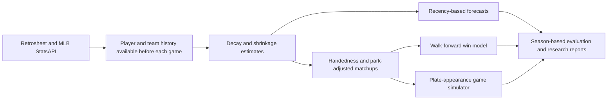

# baseball-analytics

Baseball scouting, player evaluation, and MLB game modeling. The NCAA platform combines
transfer-portal scouting, pitch-level models, hitter and pitcher Streamlit apps, and play-by-play
reports used by the University of San Diego coaching staff. The MLB work covers Statcast pitch
and contact models, run expectancy, recency-weighted forecasting, batter-pitcher matchups,
bullpen usage, and plate-appearance Monte Carlo game simulation.

MLB-trained xSLG and swing-decision models feed the NCAA hitter app; NCAA TrackMan trains the
Stuff+, whiff, and pitch-location models. The [model index](models/README.md) connects trained
artifacts to their source notebooks. Game-level MLB research has its own methods, experiments,
and evaluation reports below.

## Scouting and pitch models

| Work | What it provides | Start here |
|---|---|---|
| Hitter app | xSLG, swing/take decision value, heatmaps, spray charts, and rolling trends | [Hitter app](apps/hitter/README.md) |
| Pitcher app | Stuff+, whiff probability, movement, command and release plots, ideal locations, and reports | [Pitcher app](apps/pitcher/README.md) |
| Transfer portal | Multi-source ingestion, identity resolution, enrichment, fit scoring, alerts, and the coach board | [Portal pipeline](docs/transfer-portal-pipeline.md) |
| Play-by-play reporting | Situational battle scoring and individual-game and season PDF reports | [Pipeline](src/ncaa/pbp/) and [sample reports](docs/samples/README.md) |
| Pitch-level research | Arm angle, shoulder coordinates, 3D wOBA, effective velocity, pitch mix, bunts, umpire analysis, and scouting notebooks | [Research notebooks](research/notebooks/) |



Pitch-location analysis from the scouting tools built for USD coaches.



Pitch movement colored by Stuff+, with pitcher and date filters.

```
sources ──▶ ingest/dedupe/resolve ──▶ SQLite + dbt warehouse ──▶ models ──▶ apps + board
D1Baseball                            staging / intermediate      Stuff+     hitter app
VerbalCommits                         / marts, contracts          xWhiff     pitcher app
X/Twitter                             + source freshness          xSLG       Netlify board
CSV paste                                                         run value  (Supabase RLS)
PerfectGame bio
Sidearm bio
TrackMan
```

## MLB forecasting and game simulation

The MLB pipelines build player and team estimates from public play-by-play and game logs,
combine them into game forecasts, and evaluate them across seasons. The simulator also models
how a game unfolds, including the starter's exit and which reliever is likely to enter.

| Work | What it provides | Methods and results |
|---|---|---|
| Run expectancy and recency | Rolling hitter, starter, bullpen, and team estimates; decay windows, offseason carry, shrinkage, and recent-form experiments | [Recency study](research/r/mlb/RECENCY-PLAN.md) and [R pipeline](research/r/README.md) |
| Batter-pitcher matchup models | Handedness-specific outcome rates combined through log5, park adjustments, times through the order, bullpen availability, and walk-forward win forecasts | [Model card](research/r/mlb/MODEL-CARD.md) and [matchup experiments](research/r/mlb/MATCHUP-PLAN.md) |
| Monte Carlo game simulator | Plate appearances, batting order, base-out transitions, starter hook, reliever selection, workload, win/run distributions, and hitter-pitcher exposure | [Simulator design](research/r/mlb/SIM-PLAN.md) and [implementation](research/r/mlb/simulate.R) |
| Evaluation and market comparisons | Calibration, moneyline and totals benchmarks, closing-line value, conventional sabermetric baselines, and forward-season testing | [Research report](research/r/mlb/REPORT.md) and [evaluation figures](research/r/mlb/results/figures/) |
| Reliability and model development | Sample-size stabilization, shrinkage tuning, context ablations, and comparisons of model variants | [Research report](research/r/mlb/REPORT.md) and [experiment log](research/r/mlb/MATCHUP-PLAN.md) |



Related projects: [original R pipeline](research/r/legacy/) and
[WanBattedBall](https://github.com/tdub29/WanBattedBall), a CatBoost entry in Nick Wan’s NWDS competition.

## What is in here

| Area | Size | Notes |
|---|---|---|
| `src/ncaa/portal/` | 28 files, 5,296 lines | Portal ingest, dedupe, entity resolution, enrichment, geo, program tier, rollup, fit scoring, alerts |
| `src/ncaa/pbp/` | 25 files, 6,516 lines | NCAA play-by-play acquisition (Playwright plus `ncaa-api.henrygd.me`), situational "battle" scoring, season PDF reports |
| `src/ncaa/cli.py` | 336 lines | `init`, `import-excel`, `ingest`, `enrich-643`, `evaluate`, `board`, `run-all` |
| `warehouse/` | 18 SQL files, 925 lines | dbt-duckdb rebuild of the transform layer: 3 staging, 1 intermediate and 7 mart models (dims, `fct_pitch`, season marts), 3 singular tests, a pitch-type seed, model contracts, source freshness and sample fixtures |
| `apps/hitter/`, `apps/pitcher/` | 5,275 lines | The two Streamlit apps coaches open, with their 10 model artifacts |
| `scripts/` | 22 files | NCAA bio fetchers (D1/D2/D3/portal), school geocoding, Excel import and export, board HTML build, Netlify publish, Supabase RLS verify |
| `tests/` plus the pbp tests | 15 pytest files, 98 test functions | bio, board, d1baseball, dedupe, geo, overlay, RLS schema, pipeline, program tier, resolve, rollup, speed, status, battle calc, and a guard that the battle converter stays linear in input size |
| `research/notebooks/` | 20 notebooks | 8 MLB, 12 NCAA, outputs stripped (verified 2026-09-16: 0 of the 20 carry embedded outputs). Every shipped model was trained in one of these |
| `research/r/` | MLB pipelines, studies, simulator, and testthat suite | Run expectancy, recency and matchup models, bullpen usage, Monte Carlo game simulation, market comparisons, and forward-season evaluation. The original pipeline is preserved in `research/r/legacy/`. |
| `docs/` | 12 design docs | Pipeline design, 2026 sourcing, capabilities and blockers, Netlify and Supabase recipes, the consolidation plan |

Model provenance, which notebook trained which artifact: [`models/README.md`](models/README.md).

## Production versus research, stated plainly

The two Streamlit apps and the coach board are in active use. The dbt warehouse is a staged
rebuild of the transform layer and has **not** cut over; the SQLite pipeline is still what runs.
CI (`.github/workflows/ci.yml`) runs ruff, pytest, `dbt build` on the fixtures and the testthat suite.
Everything under `research/` is exactly that, and several notebooks depend on a TruMedia or
6-4-3 export this repo does not carry.

## Quickstart

Real data ships with this repo, so a fresh clone runs without credentials.

```bash
pip install -e ".[scoring,ncaa-stats]"
python -m ncaa.cli init --force            # create db/baseball.db from db/schema.sql
python -m ncaa.cli import-excel            # seed from the committed workbook
python -m ncaa.cli evaluate                # compute fit scores
python -m ncaa.cli board --limit 150       # write data/hot_board.csv
```

Live sources need a `config.yaml` (copy `config.example.yaml`). The D1Baseball adapter needs a
session cookie, and the Supabase overlay needs project keys; both degrade to no-op without them,
so the rest of the pipeline still runs.

The apps pin numpy against each other, so install one per environment:

```bash
pip install -e ".[hitter]"  && streamlit run apps/hitter/streamlit_app.py
pip install -e ".[pitcher]" && streamlit run apps/pitcher/streamlit_app.py
```

The warehouse builds green from a clone with zero credentials, off the fixtures in
`warehouse/sample_data/`:

```bash
pip install -e ".[warehouse]"
cd warehouse && cp profiles.example.yml profiles.yml && dbt build
```

`profiles.yml` is gitignored because it is the file that can hold credentials; the example
that ships holds two local duckdb paths and nothing else.

The MLB R pipeline runs on its own, and its tests need no network:

```bash
Rscript research/r/tests/testthat.R
Rscript research/r/mlb/run_season.R 2019   # one season end to end
```

## Sample output

`docs/samples/` holds real per-game battle reports the pbp pipeline generated for the 2026
season. `data/portal_board.html` is a published hot board.

## What this repo replaced

A manual Excel hot board plus a call-assignment spreadsheet. The interesting constraint was that
USD's `sso.ncaa.org` login needs a 2FA code from a coach on every use, so roughly 90 percent of
the workflow is built to need no login at all: entries are detected from public sources, stats
come from `collegebaseball` against `stats.ncaa.org`, and the login is spent only on contact
fields for the top call targets. `docs/transfer-portal-pipeline.md` has the full design.

## Data and attribution

Real TrackMan and portal exports are committed on purpose, because an app nobody can start is a
screenshot. The files name individual athletes and carry player IDs. USD branding, names and
data are used with permission.

Secrets are a separate matter and are not committed: `config.yaml`, `secrets/`, `.env`, keys and
service-account JSON are all ignored, and `git ls-files` is checked against that list before any
push.

## More projects

More of my work and contact details are at [twhite.dev](https://twhite.dev).
